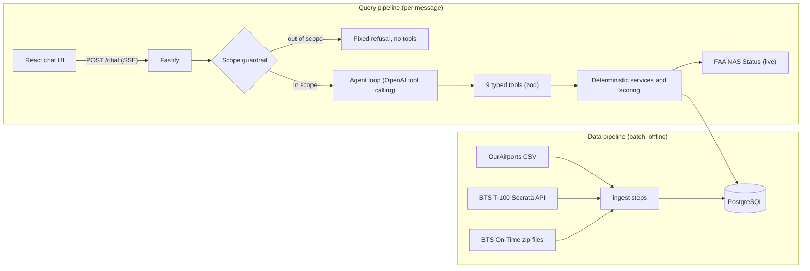

# Design and Architecture

Airport Investment Intelligence Agent: a chat agent that helps analysts screen US airports for terminal expansion opportunities, using public BTS and FAA data.

**Core principle: the LLM decides *what* to look up and *explains* the results; deterministic code computes every number.**

Contents: [1. Architecture](#1-architecture) · [2. Scoring methodology](#2-scoring-methodology) · [3. Key tradeoffs](#3-key-tradeoffs) · [4. Where and how AI is used](#4-where-and-how-ai-is-used) · [5. Assumptions and limitations](#5-assumptions-and-limitations)

---

## 1. Architecture

**Data pipeline.** Public data is loaded into Postgres ahead of time; the agent doesn't call data APIs while answering, except live FAA status.

- **Sources:** OurAirports (airport list, coordinates), BTS T-100 (passengers, seats, international traffic, 24 months), and BTS On-Time (about 7M flights, reduced to per-airport monthly totals).
- **Stored as sums and counts, not averages,** so any time window re-aggregates exactly.
- **Joined on stable identifiers, never names.** OurAirports joins T-100 on IATA code. On-Time joins on BTS's numeric airport ID, which survives code changes (Palm Beach was renamed PBI → DJT).
- **Snapshot:** a 1 MB processed snapshot is committed, so setup takes seconds.

**Query pipeline.** One message flows through these steps:

1. The UI sends the message to `POST /chat`; history is kept on the server.
2. The **scope guardrail** runs.
3. The **agent loop** calls tools (at most 10 tool executions and 8 LLM iterations, with timeouts).
4. Each tool validates its arguments and calls a **deterministic service**, which returns numbers together with their period, sources and caveats.
5. The model writes the answer, which streams to the UI with each tool step shown live.

**Tools (9):** `rank_airports`, `compare_airports`, `get_airport_profile`, `get_long_haul_share`, `get_unmet_demand_signals`, `resolve_airport`, `get_live_airport_status`, `get_live_delays_nationwide`, `get_methodology`. These are typed tools, not text-to-SQL, so the model can't query arbitrary data or invent metrics.

---

## 2. Scoring methodology

**Terminal Expansion Opportunity Screening Score (v2).** It is a screening score that ranks candidates for further due diligence, **not an investment recommendation**. Implemented as a pure, unit-tested function: `[scoring.ts](../apps/server/src/services/scoring.ts)`.

**Thesis.** Terminals are sized by passenger throughput. Renovations pay off where throughput is large and growing, and where demand is already filling the seats on offer.

| Component                    | Metric (last 12 months)                                                                   | Source      | Weight  |
| ---------------------------- | ----------------------------------------------------------------------------------------- | ----------- | ------- |
| Passenger scale              | Enplaned passengers                                                                       | BTS T-100   | **35%** |
| Passenger growth             | Passengers vs the previous 12 months                                                      | BTS T-100   | **35%** |
| Seat demand pressure         | Load factor = passengers ÷ seats                                                          | BTS T-100   | **20%** |
| Operational congestion proxy | Mean percentile of arrival delay rate, NAS delay per arrival, taxi-out, cancellation rate | BTS On-Time | **10%** |

**Method.**

- **Universe:** airports with at least 250k passengers a year (180 airports).
- **Percentiles:** each component becomes a percentile (0–100) within the universe. Units don't matter, and a single outlier can't dominate.
- **Score:** the weighted mean of the percentiles. It is stored with every component's raw value, percentile, weight, contribution and caveat, so the agent can explain any rank.
- **Deterministic:** the same data always gives the same scores.

**Why congestion has only 10% weight.** Delays and taxi times are driven by runways, air traffic control, weather and airlines, none of which a new terminal fixes. An earlier version (v1) weighted congestion at 25%. That ranked airports partly on problems a terminal can't solve, so v2 moved the weight to scale and growth. A unit test checks that congestion alone can't outrank stronger passenger fundamentals.

**Missing data.** A missing component is dropped and the remaining weights are re-normalized. Each score reports its **coverage**: `full`; `partial` (only the congestion proxy is missing, a small effect); or `limited` (growth is missing, so the score becomes mostly a size ranking). Coverage describes which components could be computed, not data quality or confidence.

**Unmet demand** (e.g. "SFO") can't be observed directly, because turned-away passengers aren't recorded. It is reported as rule-based signals, each benchmarked against peer airports: high load factor, demand growing faster than seat supply, NAS delay in the top decile, frequent arrival delays, and schedule peaking. The thresholds are explicit analyst choices.

More detail, including the re-normalization table and future components: [scoring.md](scoring.md).

---

## 3. Key tradeoffs

| Decision                                                                         | Why                                                                              | Cost                                                                                                 |
| -------------------------------------------------------------------------------- | -------------------------------------------------------------------------------- | ---------------------------------------------------------------------------------------------------- |
| **Batch ETL into Postgres** instead of calling APIs while answering              | Fast, reproducible, testable; no rate limits during a chat                       | Data lags about 3 months (BTS publication); refresh is a manual `npm run ingest`                     |
| **Deterministic scoring, LLM only explains**                                     | Same answer every time, auditable, unit-tested                                   | New kinds of analysis need code, not just a prompt                                                   |
| **Typed tools instead of text-to-SQL**                                           | Safe and predictable; tools return provenance and caveats                        | Less flexible for unusual questions                                                                  |
| **Percentile-based score**                                                       | Unit-free, robust to outliers, easy to explain ("90th percentile for growth")    | Relative to peer airports, not an absolute capacity measure                                          |
| **Weights favor scale and growth; congestion at 10%**                            | Matches what a terminal actually serves                                          | Weights are analyst judgment (explicit and versioned, so they can be challenged)                     |
| **Re-normalize missing components**                                              | Airports stay rankable                                                           | Those scores answer a slightly different question, so coverage is reported                           |
| **LLM guardrail before the agent; refuse if it fails**                           | Reliable off-topic handling that understands follow-ups; never silently approves | About 0.7 s extra per message; a classifier outage blocks valid questions (with a clear "try again") |
| **Geographic metro resolution** (50-mile radius around a city's busiest airport) | Works for any city without hardcoded lists ("LA" gives LAX, BUR, LGB, ONT, SNA)  | The radius is a heuristic (measured: real metro airports are ≤47 mi apart, the next ring ≥55 mi)     |
| **Committed 1 MB data snapshot**                                                 | Reviewer setup in seconds, without 400 MB of downloads                           | Must be regenerated after a new ingest                                                               |
| **In-memory conversations, no queues or LangChain**                              | Minimal infrastructure; the agent loop is small and fully controlled             | History is lost on restart and not shared across server instances                                    |

---

## 4. Where and how AI is used

| Task                                                                                                      | Done by                                                            |
| --------------------------------------------------------------------------------------------------------- | ------------------------------------------------------------------ |
| Understanding the question, choosing tools and arguments, resolving follow-ups ("What about California?") | **LLM**: `gpt-4o`, OpenAI Responses API with function calling      |
| Writing the explanation (direct answer, key numbers, reasoning, period, sources, caveats)                 | **LLM**                                                            |
| Deciding whether a message is in scope                                                                    | **LLM classifier**: `gpt-4o-mini`, plus narrow deterministic rules |
| All numbers: aggregation, percentiles, scores, rankings, benchmarks, unmet-demand signals                 | **Deterministic TypeScript**                                       |
| Name → airport, city → metro airports, region → states                                                    | **Deterministic** (geographic, data-driven)                        |
| Data ingestion, joins, live FAA status interpretation                                                     | **Deterministic**                                                  |

**How the agent is kept honest.**

- **Tool results carry their context:** every result includes the data period, sources, assumptions and limitations, and the system prompt requires stating them. It also requires calling the score a screening score, never presenting operational congestion as terminal evidence, and never turning "no FAA delay program" into "flights are on time".
- **Arguments are validated:** zod checks every tool argument (e.g. long-haul threshold: integer, 250–2,500, multiple of 250), and errors return to the model as data, so it can recover.
- **Hard limits:** at most 10 tool executions and 8 LLM iterations per message, timeouts on every call, and a fixed graceful message when a limit is hit.

**Guardrail (off-topic and prompt injection).**

1. **Deterministic rules** block attempts to get the system prompt or API keys and "ignore your instructions"-style overrides. They never approve a real request.
2. **The classifier** sees the latest message plus the last 4 turns as untrusted data, and returns **enum-only structured output** (no free text reaches the user).

Mixed requests are answered for the airport part only. If the classifier fails, the request is refused, not approved. This reduces the risk of prompt injection; it doesn't eliminate it.

**Evaluation.**

- 170 deterministic unit tests, with the LLM and external APIs mocked.
- A real-classifier evaluation on 52 labeled cases: in scope, follow-ups, off-topic, adversarial, mixed. Latest runs: **0 false positives, 0 false negatives**, median latency about 0.7 s.

